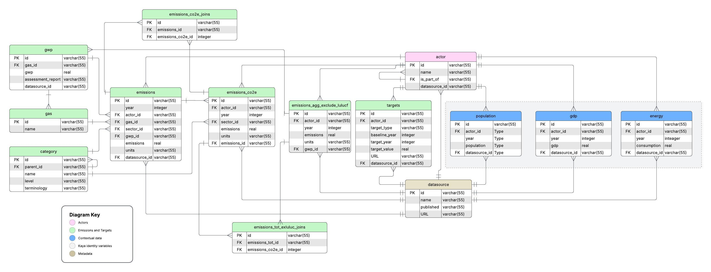

# Database Architecture

[PostgreSQL](https://www.postgresql.org/) is used as the database management system. The database models and schema are defined using the [SQLModel](https://sqlmodel.tiangolo.com/) object-relational mapper, while [Alembic](https://alembic.sqlalchemy.org/en/latest/) manages database schema migrations. This approach of keeping everything in the Python ecosystem makes the project easier to maintain. 

## Entity Relationship Diagram

The following entity-relationship diagram (ERD) shows how the tables are structured and how they interact from a high level. 

## Design Principles

The schema follows the following design principles:

- **Singular table names**. (e.g. "Actor" not "Actors")
- **Compound primary keys**. For many tables, there are compound primary keys; that is, keys with multiple columns that are unique across the table. When the table is referenced as a foreign key in many places, however, we use a single constructed identifier, which makes references simpler.
- **Provenance information provided**: We make a strong effort to include a `datasource_id` for rows that provides data provenance.
- **Timestamps** Most rows in table include a `created_at` and `updated_at` timestamp column. These mark when the data was imported or updated in the database, which helps with synchronisation and delivery over the Web. Publication of the datasource can be found in the `DataSource` table. 
- **Consistent units**  imported data sets may have varying units. When the data is pre-processed the units may be changed to match the database schema. For instance, emissions in LEDGER are provided in tonnes of gas for all records. 
- **Multiple sources of truth**. We track multiple records of the same information for emissions data to facilitate the intercomparison of methodologies. However, we only track a single source of truth for contextual data such as population, GDP, energy consumption, and emission targets.
- **Constructed identifier** Identifiers are often constructed by the data importer to be unique. A common pattern is to use a colon ':' to separate parts of an identifier that are unique. For example, datasource_id values are often composed of the publisher ID and a unique ID for the publication.

